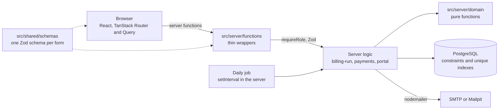

# Brightloop subscriptions

One platform for Brightloop Software's products, plans, quotations, subscriptions, recurring
invoices, payments, discounts and finance reporting, with admin, staff and customer portal access.

Built with TanStack Start, Drizzle ORM, Tailwind CSS and PostgreSQL.

## Setup

You need Node 24, pnpm and PostgreSQL 16 or newer running on this machine.

```sh
pnpm install
psql -U postgres -c "create role brightloop login password 'CHOOSE_A_PASSWORD'" -c "create database brightloop owner brightloop" -c "create database brightloop_test owner brightloop"
cp .env.example .env    # then put the same password in DATABASE_URL
pnpm db:setup           # applies the migrations, then loads the demo data
pnpm dev
```

Open <http://localhost:3000>. Run `pnpm test` to check everything.

The app connects as `brightloop`, which owns the database, and never as the `postgres` superuser.
The tests use `brightloop_test` and refuse to run against any database whose name does not end in
`_test`, so they cannot touch your demo data.

## Demo accounts

The password for every account is `Brightloop@2026`.

| Role     | Email                                                           |
| -------- | --------------------------------------------------------------- |
| Admin    | `admin@brightloop.example`                                      |
| Staff    | `staff@brightloop.example`                                      |
| Customer | `asha@`, `vikram@`, `neha@`, `arjun@`, `priya@customer.example` |

These passwords are public. Do not seed them into a database other people can reach, or change
them first.

## Demo script

1. Sign in as `admin@brightloop.example`. The **Dashboard** shows active subscriptions, MRR, revenue,
   what is outstanding and overdue, and how late the overdue invoices are. Change the plan or
   customer filter and watch every number move.
2. Open **Invoices**. The seed has drafts, confirmed, paid and overdue invoices. Open one to see
   its lines, payments and actions. **Print** opens a clean page you can save as a PDF.
3. Open **Billing**. The history shows billing was run up to yesterday. Press **Run billing now** for
   today: invoices are created for the subscriptions that are due, and the **Welcome 10%** and
   **Storage saver** discounts appear as negative lines.
4. Press **Run billing now** again. It creates nothing, because each period can only be billed once.
5. On **Invoices**, press **Confirm all drafts**, open one, and **Record a payment** for part of the
   amount. It stays confirmed. Record the rest and it becomes paid.
6. Open **Subscriptions**, create one from a quotation template, and take it from Draft through
   Quotation and Confirmed to Active. Pause, Close and Renew appear only where the plan allows.
7. Open **Discounts** (admin only) to see how many uses each discount has left.
8. Sign in as `asha@customer.example`. The portal shows only Asha's subscriptions and invoices. Pause
   or close a subscription where the plan allows it.
9. Try to open another customer's invoice by its address. It is a 404.

## Architecture



- **Domain** (`src/server/domain`): tax, subscription and invoice state machines, billing periods,
  discount selection and payment rules. Pure functions with no framework or database imports.
- **Server logic** (`src/server`): billing run, payments, portal queries and dashboard queries. Each
  takes the database as a parameter, so tests and the seed use their own connection.
- **Server functions** (`src/server/functions`): check the role, validate with Zod, call the above.
- **Database**: the schema carries the rules too: unique indexes, check constraints and foreign keys.

## Scripts

| Command                | What it does                                                               |
| ---------------------- | -------------------------------------------------------------------------- |
| `pnpm dev`             | Starts the app on port 3000                                                |
| `pnpm db:generate`     | Writes a migration from `src/db/schema.ts`                                 |
| `pnpm db:migrate`      | Applies migrations                                                         |
| `pnpm db:seed`         | Adds demo data, with billing history, to an empty database                 |
| `pnpm db:seed --reset` | Wipes all data and reseeds; refused in production                          |
| `pnpm db:setup`        | Runs `db:migrate`, then `db:seed`                                          |
| `pnpm db:seed:perf`    | Adds about 5,000 subscriptions and 30,000 invoices; `--clean` removes them |
| `pnpm db:explain`      | Runs `EXPLAIN ANALYZE` on the dashboard queries                            |
| `pnpm test`            | Runs Vitest, including the database tests                                  |
| `pnpm typecheck`       | Runs TypeScript                                                            |
| `pnpm lint`            | Runs Biome                                                                 |

`db:seed:perf` only runs on a database whose name ends in `_test` or `_perf`, to protect the demo.
For example, set `DATABASE_URL` to the `brightloop_test` database for one command, run
`pnpm db:setup`, `pnpm db:seed:perf` and `pnpm db:explain`, then `pnpm db:seed:perf --clean`.

## Email

With `SMTP_HOST` empty, development prints emails to the server console, including password reset
links and sent invoices. To use Mailpit instead, run `docker compose up -d`, set
`SMTP_HOST=localhost`, and read mail at <http://localhost:8025>. With `NODE_ENV=production` and no
SMTP provider, emails fail.

## Daily billing

The server starts a plain interval on its first request (no job library). It checks every ten minutes
and, during `BILLING_HOUR` (2 am India time by default), runs billing if no scheduled run has happened
that day. If the server was off then, the next run catches up every missed period. Set
`BILLING_SCHEDULER=off` in `.env` to bill only from the Billing page, which is handy for demos.

## Assumptions

### General

- The database is PostgreSQL installed on the machine, not Docker Postgres as in the original brief.
  See `docs/WORKING_RULES.md`.
- Authentication is custom: bcrypt passwords, hashed session and reset tokens, and an httpOnly
  SameSite=Lax cookie. Sessions last 7 days. Resetting a password signs out all of that user's
  sessions.
- Row Level Security is on for every table with no policies. The app connects as the table owner, so
  it is unaffected, and any other role is locked out. This is defence in depth.
- Business dates follow the Asia/Kolkata calendar, whatever time zone the server runs in.
- Money is integer paise, prices are tax-exclusive, and tax is rounded half-up per line.
- `discounts.value` is a whole percent for percent discounts and paise for fixed discounts.
- `invoices.customer_snapshot` was added to the brief's columns, so old invoices keep the customer
  details they were billed with. `invoice_lines` allows negative amounts, because discounts are
  negative lines.
- `subscriptions.expiry_date` is optional, for open-ended subscriptions.
- Only one tax rule can be the default. Saving a new default demotes the old one.

### Catalogue and subscriptions

- A subscription's first line is the plan's base fee. It has no product, uses the default tax rule,
  and its quantity is the "plan quantity", which must meet the plan's minimum.
- A line's unit price and tax rate are copied when the line is added. Changing a product's price or a
  tax rule later does not change existing lines or the invoices billed from them.
- `quotation_valid_until` is set only for subscriptions created from a template (creation date plus
  the template's validity days).
- Staff and admin can both create and edit templates. Only admin edits products, plans, taxes,
  payment terms and discounts; staff see products and plans read-only.
- Moves are defined in one table in `src/server/domain/subscription-state.ts`. A subscription can be
  closed from any state, but a running one can only be closed before its expiry date if the plan
  allows early close.
- Renew is offered on Active and Closed subscriptions, once only, and needs an expiry date. It
  creates a Draft with the same lines, starting the day after expiry and lasting the same number of
  days.
- Inactive products and plans cannot be added to new subscriptions.

### Billing, invoices and payments

- **No proration.** Plan and quantity changes apply from the next period.
- An invoice's issue date is the start of the period it bills, and its due date is the issue date
  plus the payment terms. Catching up three missed months therefore creates three invoices dated in
  those months, some of which may already be overdue.
- Billing copies each subscription line, including the tax rate copied on it.
- Billing's pure rules (periods, totals, discounts) are in `src/server/domain/billing.ts`. The part
  that touches the database is `runBilling` in `src/server/billing-run.ts`, because domain files may
  not import the database.
- A subscription that has reached its expiry date stops billing. A plan with `auto_close` closes it
  once the expiry date has passed, not on the day its last period is invoiced.
- One run bills at most 400 periods per subscription. A longer gap finishes over the next runs.
- Invoice numbers come from a sequence, so a repeat-billing attempt can leave a gap in the numbers.
- **Partial payments are allowed**, overpayment is rejected, and a payment cannot be dated in the
  future or before the invoice. **There are no refunds**, so an invoice with payments cannot be
  cancelled.
- **Overdue is derived**: confirmed, amount due above zero, and due date before today. It is never
  stored.
- **Outstanding** on the dashboard counts confirmed invoices only. Drafts are not yet owed.
- MRR scales each active subscription's tax-exclusive per-period total: daily x 30, weekly x 52/12,
  monthly as is, yearly / 12.

### Discounts

- **One discount per scope**: at most one per product line and one for the subscription, whichever
  saves most. A rule applies once per invoice.
- A discount is judged on the invoice's issue date: it must be active, inside its date window, meet
  its minimum purchase and quantity, and have uses left. It stops by itself when it expires or runs
  out.
- The subscription discount is taken from what is left after product discounts, and each discount
  reduces the tax with it.
- Uses are counted atomically in the same transaction as the invoice, and an invoice that turns out
  to already exist does not use one up.

### Customer portal

- A customer sees only their own data. Anything else, including a draft, is a 404.
- Customers see issued invoices (confirmed and paid) and subscriptions beyond the draft stage.
- Customers can pause, resume or close a running subscription where the plan allows it, through the
  same state machine staff use.
- The seed has 16 subscriptions across every status. One quotation is already expired, one plan
  (Launch offer) is past its availability window, and the last draft is a renewal of the closed one.
